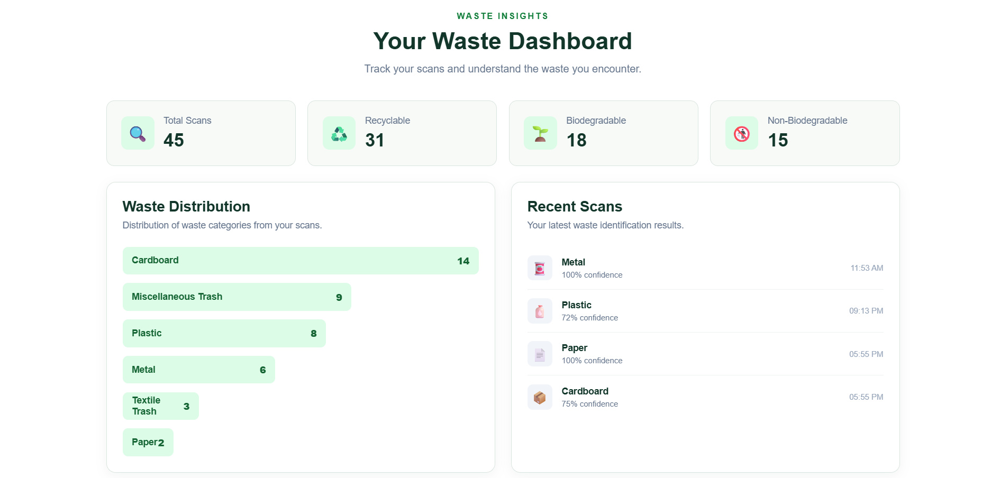

# 🌿 WasteWise — AI-Powered Smart Waste Scanner

**Know Your Waste. Make a Difference.**

WasteWise is an AI-powered waste identification application that uses computer vision to classify waste images into nine categories and provide basic disposal guidance.

The project combines a YOLOv8n image-classification model with a React frontend, FastAPI backend, and SQLite database to create an interactive waste-scanning experience.

---

## 📌 Project Overview

Waste segregation is an important step towards sustainable waste management. However, identifying the correct waste category and understanding its disposal method can sometimes be confusing.

WasteWise aims to simplify this process by allowing users to upload an image or capture a photograph of a waste item. The trained AI model predicts its category and provides relevant information, including waste type, recyclability, compostability, and disposal recommendations.

## ✨ Key Features

- **AI-Powered Waste Classification:** Identifies waste using a trained YOLOv8n classification model.
- **Image Upload:** Upload an image for waste identification.
- **Webcam Scanning:** Capture images directly through the browser.
- **Nine Waste Categories:** Recognises nine different categories of waste.
- **Disposal Guidance:** Provides information about waste type, recyclability, compostability, and disposal.
- **Confidence-Based Results:** Uses a 70% confidence threshold to identify uncertain predictions.
- **Scan History:** Stores accepted scan records using SQLite.
- **Dashboard:** Displays waste statistics and distribution.
- **Responsive Interface:** Clean and modern green-and-white interface.

---

## 🗑️ Supported Waste Categories

WasteWise currently recognises nine categories:

| Category | Waste Type |
|---|---|
| Cardboard | Biodegradable |
| Food Organics | Biodegradable |
| Glass | Non-biodegradable |
| Metal | Non-biodegradable |
| Miscellaneous Trash | General / Mixed Waste |
| Paper | Biodegradable |
| Plastic | Non-biodegradable |
| Textile Trash | Special / Textile Waste |
| Vegetation | Biodegradable |

---

## 🖥️ Application Screenshots

### Home Page


### Waste Scanner


### Prediction Result


### Dashboard


### Scan History


---

## 🧠 Machine Learning Model

WasteWise uses **YOLOv8n Classification (YOLOv8n-cls)** for image classification.

Unlike object detection models, the classification model predicts one category for the entire image. It does not identify multiple objects or generate bounding boxes.

### Model Development

Three model experiments were conducted.

| Model | Description |
|---|---|
| V1 | Original nine-class baseline model |
| V2 | Intermediate experiment using balanced training data |
| V3 | Fine-tuned model using an additional dataset and data augmentation |

### V1 vs V3 Evaluation

Both models were evaluated using direct inference on the same 957 original test images.

| Metric | V1 | V3 |
|---|---:|---:|
| Test Images | 957 | 957 |
| Correct Predictions | 875 | 860 |
| Incorrect Predictions | 82 | 97 |
| Top-1 Accuracy | 91.43% | 89.86% |
| Macro F1 | 0.9181 | 0.90 |

**Selected Production Model: V1**

Although V3 achieved 93.4% validation accuracy, it did not outperform V1 on the original test set.

Therefore, V1 was retained as the application model, while V3 remains an experimental checkpoint.

### Training Technologies

- YOLOv8n Classification
- Ultralytics
- PyTorch
- Albumentations
- Kaggle GPU (Tesla T4)

---

## 🏗️ System Architecture

WasteWise follows a component-based frontend and backend architecture.

```text
             USER
               |
               v
       REACT FRONTEND
               |
        Upload / Capture
               |
               v
        FASTAPI BACKEND
               |
               v
       PREDICTOR.PY
               |
               v
        YOLOV8N MODEL
          (best.pt)
               |
               v
       PREDICTED CLASS
               |
               v
        WASTE_INFO.PY
               |
               v
       DISPOSAL GUIDANCE
               |
          +----+----+
          |         |
          v         v
       SQLITE    JSON RESPONSE
       DATABASE       |
                      v
               REACT FRONTEND
                      |
                      v
                RESULT DISPLAY
```

### Technology Stack

| Layer | Technologies |
|---|---|
| Frontend | React 19, Vite, JavaScript, CSS |
| Backend | Python, FastAPI, Uvicorn |
| Machine Learning | YOLOv8n-cls, PyTorch, Ultralytics |
| Image Processing | Pillow, NumPy |
| Database | SQLite |
| Model Training | Kaggle, Albumentations |
| Development Tools | VS Code, Git, GitHub |

---

## 📂 Project Structure

```text
WasteWise/
│
├── frontend/
│   ├── public/
│   ├── src/
│   │   ├── components/
│   │   │   ├── Navbar.jsx
│   │   │   ├── Hero.jsx
│   │   │   ├── Scanner.jsx
│   │   │   ├── Categories.jsx
│   │   │   ├── Dashboard.jsx
│   │   │   ├── History.jsx
│   │   │   └── About.jsx
│   │   │
│   │   ├── api.js
│   │   ├── App.jsx
│   │   ├── App.css
│   │   └── index.css
│   │
│   ├── package.json
│   └── vite.config.js
│
├── backend/
│   ├── models/
│   │   └── best.pt
│   │
│   ├── test_images/
│   ├── app.py
│   ├── predictor.py
│   ├── waste_info.py
│   ├── database.py
│   ├── requirements.txt
│   └── wastewise.db
│
├── docs/
│   ├── WasteWise_Technical_Project_Report.pdf
│   └── screenshots/
│       ├── homepage.png
│       ├── scanner.png
│       ├── prediction.png
│       ├── dashboard.png
│       └── history.png
│
└── README.md
```

---

## ⚙️ Installation and Setup

Follow these steps to run WasteWise locally.

### Prerequisites

- Python
- Node.js and npm
- Git

### 1. Clone the Repository

```bash
git clone YOUR_GITHUB_REPOSITORY_URL
cd WasteWise
```

### 2. Backend Setup

Navigate to the backend directory:

```bash
cd backend
```

Create a Python virtual environment:

```bash
python -m venv .venv
```

Activate the environment.

**Windows PowerShell:**

```powershell
.\.venv\Scripts\Activate.ps1
```

Install the dependencies:

```bash
pip install -r requirements.txt
```

Ensure that the trained model exists at:

```text
backend/models/best.pt
```

### 3. Start the Backend

Run:

```bash
python -m uvicorn app:app --reload
```

The backend will run at:

```text
http://127.0.0.1:8000
```

API documentation:

```text
http://127.0.0.1:8000/docs
```

### 4. Frontend Setup

Open another terminal and navigate to the frontend directory:

```bash
cd frontend
```

Install dependencies:

```bash
npm install
```

Start the development server:

```bash
npm run dev
```

The frontend will be available at:

```text
http://localhost:5173
```

---

## 🔌 API Endpoints

The FastAPI backend provides the following endpoints:

| Method | Endpoint | Description |
|---|---|---|
| GET | `/` | Checks API status |
| POST | `/predict` | Accepts an image and returns its prediction and disposal guidance |
| GET | `/history` | Retrieves stored scan records |

### Example Prediction Response

```json
{
  "success": true,
  "class": "Plastic",
  "confidence": 0.8322,
  "type": "Non-biodegradable",
  "recyclable": "Yes*",
  "compostable": "No",
  "disposal": "Send to plastic recycling where accepted"
}
```

The actual prediction and confidence depend on the uploaded image.

---

## 📊 Model Limitations

- The model predicts one category for the entire image.
- Multiple objects in a single image may lead to ambiguous predictions.
- Classification confidence does not guarantee correctness.
- Material identification is based on visible image patterns, not chemical composition.
- Recycling acceptance depends on local facilities and waste conditions.
- The model requires further testing using independently collected real-world images.

---

## 🚀 Future Enhancements

- Deploy the application for public access.
- Improve classification using independently collected real-world images.
- Investigate confidence calibration and unknown-class rejection.
- Integrate ESP32-CAM for image capture.
- Add a TFT display for displaying waste classification results.
- Improve dashboard analytics and waste insights.

---

## 📄 Technical Project Report

The complete technical documentation, including dataset preparation, model training, comparative evaluation, implementation details, and limitations, is available here:

[**View WasteWise Technical Project Report (PDF)**](docs/WasteWise_Technical_Project_Report.pdf)

---

## 👨‍💻 Developer

**Prayas Mangrati**

B.Tech – Computer Science and Engineering  
Sikkim Manipal Institute of Technology

---

## 📜 Acknowledgements

- Ultralytics for YOLO implementation.
- Kaggle for providing datasets and GPU resources.
- FastAPI for backend development.
- React and Vite for frontend development.
- Albumentations for image augmentation.

---

**WasteWise — Cleaner Today · Greener Tomorrow 🌿**
